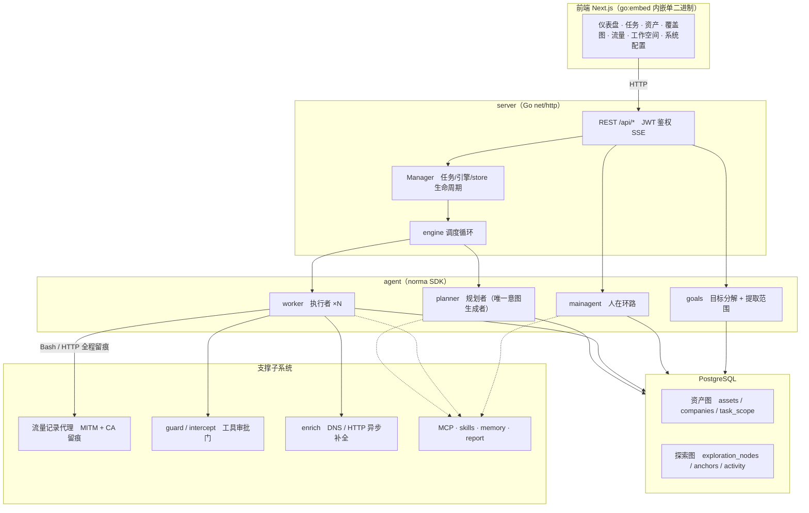
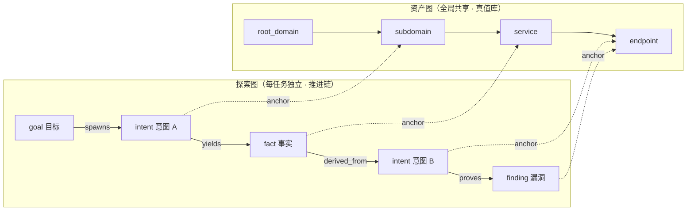
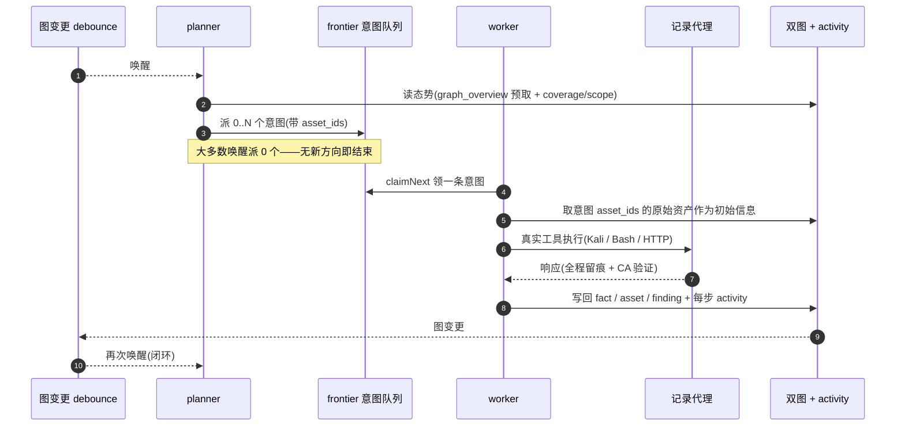
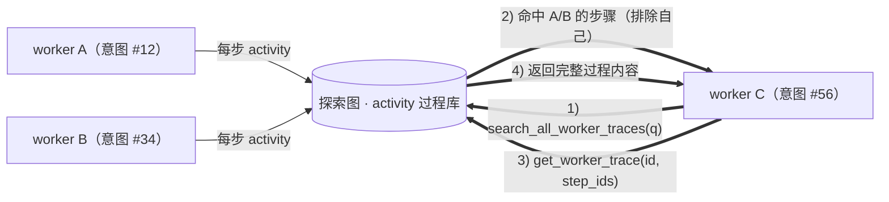
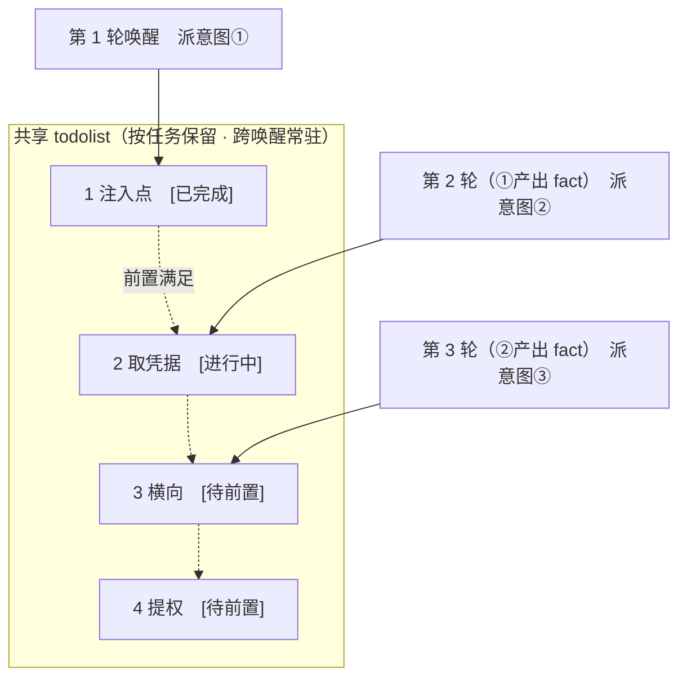

<div align="center">

# ARTEX

AI 自主渗透测试系统（Go 后端 + Next.js 前端）


🌐 **上游在线 Demo**： [https://artex-demo-ruoji6.vercel.app/](https://artex-demo-ruoji6.vercel.app/)

</div>

本仓库为独立维护的 [jishengkele/naxia](https://github.com/jishengkele/naxia)，基于 [RuoJi6/ARTEX](https://github.com/RuoJi6/ARTEX) 与 [Autumn-27/ARTEX](https://github.com/Autumn-27/ARTEX)，保留原有来源说明和 AGPL-3.0 许可证。程序发布包及页面在线更新使用本仓库 Releases；程序名称和发布包前缀继续使用 `artex`。本项目容器镜像发布到 GitHub Container Registry：`ghcr.io/jishengkele/naxia`。

本仓库正式版本从 **v1.0.0** 开始。推送代码自动运行 CI，通过后由维护者手动构建发布；发布流程自动递增版本，并将同一版本写入程序、Docker 镜像标签和 GitHub Release。详见[维护者发布流程](#维护者通过-github-actions-发布在线更新)。

---

## 截图预览

> 完整交互见[上游在线 Demo](https://artex-demo-ruoji6.vercel.app/)。

| 仪表盘（总览 / Token 消耗 / 活动流） | 任务列表 |
| :---: | :---: |
|  |  |

| 任务 · 执行过程（会话 / 工具调用） | 探索链路 |
| :---: | :---: |
|  |  |

| 发现 | 资产 |
| :---: | :---: |
|  |  |

| 资产覆盖图（力导向布局 · 已测高亮 · 节点折叠展开） |
| :---: |
|  |

| 流量录制 | 人在环路对话 |
| :---: | :---: |
|  |  |

| Agent 管理 | LLM 配置 |
| :---: | :---: |
|  |  |

| 拦截审批 | 后端日志 |
| :---: | :---: |
|  |  |


---

## 审批记录详情

全局「审批记录」、任务内「拦截审批」及对话中的审批卡片均支持展开查看详情。展示结构参考
[AegisHook 的审批详情组件](https://github.com/RuoJi6/AegisHook/blob/main/web/src/components/CallDetail.vue)，沿用 ARTEX 的组件和主题：


## 资产同步（ScopeSentry）

支持从 [ScopeSentry](https://github.com/Autumn-27/ScopeSentry) 直接同步资产数据，免去重复收集：

- 在「**资产同步**」页填 ScopeSentry 的地址与 API Key，接入数据源；
- 按**项目**或**任务**维度选择要同步的目标与资产类型（域名 / 子域 / IP / 端口 / 站点 / 端点…）；
- 一键导入并按公司资产范围归并，直接进入 ARTEX 的资产图供 agent 探索使用。

---

## 部署自己的在线 Demo（随正式 Release 自动更新）

Demo 只运行 `web/` 前端，构建时启用 `NEXT_PUBLIC_MOCK=1`，不需要 Go、PostgreSQL 或模型密钥。界面使用模拟数据，不执行真实扫描。

发布链路：正式版本的程序包、`SHA256SUMS` 和 Docker 镜像全部成功发布 → `release.yml` 的 `demo` job 调用 `demo.yml` → 检出该版本标签的提交 → 构建 Mock 前端 → 部署至 Vercel 的固定生产域名。普通 main 推送、仅创建标签、失败的发布、草稿和预发布版本都不会更新 Demo。新版本功能的演示数据仍需由维护者同步维护 `web/src/lib/mock/`。

### 首次配置 Vercel

1. 在自己的 Vercel 账号创建空项目，设置名称（例如 `artex-demo-ruoji6`）。保持 **Git 未连接**，避免每次提交都自动部署。`web/vercel.json` 也禁用了 Git 自动部署。
2. 在 **Settings → Build and Deployment** 中选择 **Next.js**、Node.js **22.x**，安装命令可覆盖为 `npm ci`，构建命令为 `npm run build`，Output Directory 保持默认。**Root Directory 留空**：此工作流从检出的 `web/` 目录调用 Vercel CLI，不能再填一层 `web`。
3. 在项目的 **Environment Variables** 中添加 `NEXT_PUBLIC_MOCK=1`，至少应用于 **Production**。不要设置 `NEXT_EXPORT=1`，也不要填写数据库连接或模型密钥。
4. 在项目 **Settings → General** 复制 **Project ID**；在团队 **Settings → General** 复制 **Team ID**（对应 `VERCEL_ORG_ID`）。确认 **Domains** 中有准备使用的生产域名。
5. 在 Vercel **Account Settings → Tokens** 创建部署 Token，范围选择项目所在团队，并设置适当有效期。将其直接保存到 GitHub 仓库 **Settings → Secrets and variables → Actions → Secrets**，名称为 `VERCEL_TOKEN`。令牌不要写入仓库、README 或聊天；到期后更新这个 Secret。

在同一 GitHub 设置页的 **Variables** 中添加：

| 变量 | 值 |
| --- | --- |
| `VERCEL_ORG_ID` | Vercel Team ID |
| `VERCEL_PROJECT_ID` | Vercel Project ID |
| `DEMO_URL` | 固定公开生产网址，含 `https://`，例如 `https://artex-demo-ruoji6.vercel.app` |

### 首次部署与重试

将配置合并到默认分支后，打开 **Actions → deploy-demo → Run workflow**，分支选 `main`，tag 留空或填写当前最新正式版（例如 `v1.0.0`）。工作流只接受已发布且包含五个平台程序包和校验文件的最新正式版，也能部署尚未包含此工作流的历史正式版。无需重新发 Release 或移动已有标签。

工作流会将这个专用 Demo 项目的框架设为 Next.js、Node 设为 22.x、根目录设为空、安装命令设为 `npm ci`、构建命令设为 `npm run build`，并确保 Production 环境的 `NEXT_PUBLIC_MOCK=1`，随后绑定 `DEMO_URL` 指定的域名。请使用独立项目；后续部署会继续维护这些配置。

成功后访问生产域名，并检查 `/demo-version.json` 中的 `tag`、`commit` 和 `mock: true`。确认可访问后，将 README 顶部和截图区域的旧 Demo 链接一起改为自己的生产域名。

此后按正常流程发布更高版本即可自动更新 Demo。若 Demo 部署失败，已发布的程序包和镜像仍然有效，旧 Demo 通常继续提供服务；修复设置后单独重跑 `deploy-demo`，不必重新发布整个 Release。两个版本同时发布时，部署串行执行，并在构建前、上线前检查 latest，避免已过期的构建覆盖新版。

这里采用发布流程直接调用部署 job，是因为使用 `GITHUB_TOKEN` 创建的 Release 不会继续触发另一个 `release: published` 工作流。`demo.yml` 也监听网页手工发布的 Release，经过同样的正式版、完整发布包和 latest 检查后部署；手工重试则运行 `deploy-demo`。

---

## 安装

> 依赖数据库 **PostgreSQL**；探索需配置 **LLM**（`ANTHROPIC_API_KEY` 或 `OPENAI_API_KEY`，也可在 UI 里配）。

### 方式一：一键安装脚本（推荐）

```bash
git clone https://github.com/jishengkele/naxia.git
cd naxia
./install.sh
```

脚本会：检测 / 自动安装 Docker → 让你选 **① 全部 Docker** 或 **② 本地编译运行**：

- **① 全部 Docker**：填一个 Postgres 密码（可回车随机）→ 自动写 `.env` → `docker compose up -d`。
- **② 本地运行**：选数据库（连已有 / 用 Docker 起一个）→ 生成 `config.json` → `go` 编译内嵌单二进制 → 启动。

装好后打开 **http://localhost:8787**（首次进入 `/setup` 设置管理员密码）。

### 方式二：Docker Compose（手动）

```bash
git clone https://github.com/jishengkele/naxia.git
cd naxia
cp .env.example .env          # 填 POSTGRES_PASSWORD、可选 ANTHROPIC_API_KEY
docker compose up -d          # 拉取 ghcr.io/jishengkele/naxia 镜像 + postgres
# → http://localhost:8787
```

镜像已含常用工具（ripgrep/curl/vim/npm/nmap…）；`./skills` 与 `./data` 以绑定挂载持久化。

`.env` 中默认 `ARTEX_IMAGE=ghcr.io/jishengkele/naxia`，`ARTEX_TAG=latest` 使用最新镜像，也可固定为已发布的正式版本标签，例如 `ghcr.io/jishengkele/naxia:v1.0.0`。工作流构建 `linux/amd64` 和 `linux/arm64` 镜像，Docker 会自动选择与宿主机匹配的架构。初次部署请修改 `POSTGRES_PASSWORD`。

镜像须先由本仓库正式发布工作流构建并推送，修改地址本身不会生成镜像。GHCR 首次创建的包默认私有；维护者需在 GitHub 账号的 Packages → naxia → Package settings 中将可见性设为 Public，之后服务器可以匿名拉取。私有镜像则需先使用有 `read:packages` 权限的凭据登录 `ghcr.io`。已有 `.env` 不会被脚本覆盖，迁移时需自行把其中的旧 `ARTEX_IMAGE` 改为新地址。

远程 MCP 可在系统设置中选择 `http`（Streamable HTTP）或 `sse`（旧版 SSE）。
旧版 SSE 服务通常使用 `GET /sse` 建立事件流，再通过服务返回的
`/message?sessionId=...` 接收 JSON-RPC 请求；配置时将 URL 填为 `/sse`，请求头按
`Authorization=Bearer <token>` 填写。

### 方式三：下载预编译二进制（Releases）

到本仓库的 [Releases](https://github.com/jishengkele/naxia/releases) 下载对应平台的 zip，解压后得到 `artex` + `start.sh`（Windows 为 `start.bat`）+ `skills/` + `config.example.json`。Linux ARM64（包括 ARM64 Kali）选择 `linux-arm64`，x86_64 选择 `linux-amd64`：

```bash
cp config.example.json config.json   # 填好 database 连接
./start.sh                           # → http://localhost:8787
```

> 请用 `start.sh` / `start.bat` 启动，而不是直接跑 `./artex`。它是个守护脚本：程序退出后按退出码决定是否重新拉起，**页面上的[一键更新](#方式一页面一键更新推荐)靠它完成换装**。直接运行 `./artex` 时更新完就不会被拉起了。
> 后台常驻：`nohup ./start.sh >artex.log 2>&1 &`。

### 方式四：从源码编译单二进制

```bash
# 1) 前端静态导出
cd web && npm ci && npm run build:static && cd ..
# 2) 拷进内嵌目录
cp -r web/out server/webui/dist
# 3) 编译（-tags embedui 才内嵌前端）
CGO_ENABLED=0 go build -tags embedui -o artex ./cmd/artex
./start.sh
```

### 方式五：构建跨平台 Release 压缩包

`build.sh` 会先构建并嵌入前端，再使用 Go linker 去除调试信息，并将发布文件压缩为 zip。Release 模式默认生成 Linux amd64/arm64、macOS amd64/arm64 和 Windows amd64 的 zip 包：

```bash
./build.sh --release
# 产物：dist/artex-1.0.0-*.zip
```

UPX 自解压二进制可能与部分 Linux 内核、虚拟化环境或安全策略不兼容，因此默认不启用。可用 `ARTEX_TARGETS` 自定义目标；确认目标运行环境兼容时，可显式传入 `--upx` 进一步缩小二进制：

```bash
ARTEX_TARGETS=linux/amd64,windows/amd64 ./build.sh --release
./build.sh --target linux/amd64 --upx
```

---

## 更新升级

> 升级只换程序、不动数据：Postgres 数据卷 `pgdata`、`./data`（jwt.key / SQLite 等）、`./skills` 都会保留。**数据库迁移无需手动执行**——`artex` 每次启动会幂等重跑 `schema.sql`（含 `ADD COLUMN` / `CREATE INDEX IF NOT EXISTS`），即“重启即迁移”。升级前仍建议先备份 `./data` 与数据库。

### 方式一：页面一键更新（推荐）

在 **系统配置** 页（侧边栏「系统配置」→ `/system/settings`）的**版本与更新**卡片里，可以直接检查并安装新版本，无需登录服务器。

本仓库构建的程序固定从 `jishengkele/naxia` 的最新正式 GitHub Release 检查更新，跳过草稿和预发布版本。已安装的上游程序仍使用其编译时的更新源，因此首次切换必须手动安装本仓库构建的程序；以后发布更高的三段式版本即可通过页面升级。仅推送 main 或 Git 标签但未发布 Release，不会产生可在线安装的新版本。

点「更新」后：下载当前平台的发布包 → 比对 Release 的 `SHA256SUMS` → 用 `-h` 冒烟测试新二进制 → 暂存为 `artex.new` → 程序退出，由 `start.sh` / `start.bat` 重新拉起并完成换装。页面会自动等到新版本上线后刷新。

- **失败不会留下坏程序**：校验或冒烟不通过就丢弃暂存件、继续跑当前版本；换装后的新版若连续 3 次启动失败，会自动回滚到 `artex.old`（失败的那个留作 `artex.failed` 供排查）。
- **随时可回退**：上一版本保留为 `artex.old`，卡片上有「回滚到上一版本」。注意数据库结构不会回退。
- **更新会中断正在运行的任务**——更新即重启，请在空闲时进行。
- **开发构建不给更新**：版本号是 `dev` 或 `git describe` 带后缀时禁用，避免正式版覆盖掉本地调试的二进制。
- **Docker 下只换程序、不换镜像**：镜像里的 playwright / nmap 等工具链不会跟着升级，且 `docker compose up -d` 重建容器后会退回镜像自带的版本。要连镜像一起升级仍请用 `docker compose pull artex && docker compose up -d artex`。
- **更新代理（可选）**与其他代理设置使用相同的「地址输入框 + 保存」方式。填写独立更新代理后保存，例如 `http://127.0.0.1:7897`；支持 `http://`、`https://`、`socks5://`、`socks5h://` 及用户名密码认证。清空并保存即为直连，不受全局代理或 `HTTP_PROXY` / `HTTPS_PROXY` 环境变量影响。保存后自动重新检查，检查版本、校验和下载和发布包下载使用同一个出口。更新只从 GitHub 域名下载并强制 HTTPS。
- 代理地址由 **ARTEX 服务端**访问。Docker 内的 `127.0.0.1` 指容器自身；代理运行在宿主机时，应使用容器可达地址（Docker Desktop 通常为 `http://host.docker.internal:7897`），并允许容器访问代理端口。

### 维护者：通过 GitHub Actions 发布在线更新

日常流程为 **推送 main → 等待 CI 全绿 → 手动运行 release**。推送代码和创建标签都不会自动构建或发布 Docker 镜像。

1. 推送提交至 `main`，打开 [Actions → CI](https://github.com/jishengkele/naxia/actions/workflows/ci.yml)。CI 执行 Go vet、全部 Go 测试（每个包使用独立 PostgreSQL 数据库）、前端类型检查、前端回归测试与静态构建，以及版本分配和发布保护测试、工作流校验。数据库连接失败导致的测试跳过也会使 CI 失败。服务端测试以目标 Docker/root 部署相同的 root 权限运行，验证 Linux 归档所需的 `/proc` 后台写入检查，不忽略权限错误。
2. 该提交的 CI 全部通过后，打开 [Actions → release](https://github.com/jishengkele/naxia/actions/workflows/release.yml)，点击 **Run workflow**，分支选择 **main**。不需要输入版本或手工创建标签。流程要求所选提交仍为最新 main，并且同一提交最新一轮 CI 已成功；条件不满足时停止，不分配版本。
3. 流程自动分配下一个版本并固定该提交，导出前端、构建五个平台的 ZIP 与 `SHA256SUMS`，构建和验证 Docker 镜像，最后公开 GitHub Release。镜像地址为 `ghcr.io/jishengkele/naxia:v1.0.0` 等正式标签，并更新 `latest`。

自动版本规则：首次 **v1.0.0**，下一次 **v1.0.1**；修订号和次版本使用 0–99，`v1.0.99 → v1.1.0`，`v1.99.99 → v2.0.0`。以仓库中已分配的正式版本标签为准，上游 `v0.x` 和预发布标签不参与计算。推送源码本身不会增加版本。程序界面显示的版本由构建时注入的发布标签决定，无需为每次构建另改源码中的版本。

发布串行执行，分配标签时不覆盖已有标签。**版本分配后即被占用**：后续构建失败也保留标签，因此可能跳号。使用 **Re-run failed jobs** 续跑同一版本；重新点击 **Run workflow** 或 **Re-run all jobs** 会重新分配下一个版本。已经公开的版本拒绝原地覆盖，请新发起发布生成更高版本；不要删除或移动旧标签来复用版本。并发提交多个发布请求时，GitHub 可能替换尚在排队的请求，建议等当前发布结束后再发起下一次。

工作流使用 Node.js 22 和 `go.mod` 指定的 Go 版本。Release 目标自动使用工作流所在的仓库 `${{ github.repository }}`，镜像默认使用 `ghcr.io/` 加小写仓库全名。GHCR 默认使用自带的 `GITHUB_TOKEN`，仅镜像 job 获得 `packages: write`；无需 Docker Hub 凭据。AMD64 和 ARM64 镜像在各自原生 runner 上连接临时 PostgreSQL 验证启动、版本和内嵌前端，两种架构均通过后才发布正式镜像和 Release。账号或组织若限制包发布，需先允许该仓库工作流发布对应包。

保留原有可选配置：Actions 变量 `ARTEX_PUBLISH_DOCKER=false` 只发布程序包；`ARTEX_DOCKER_IMAGE` 可覆盖为 `ghcr.io/所有者/镜像名` 或 `DockerHub用户名/镜像名`（均不带标签）。显式选择 Docker Hub 时使用 Secrets `DOCKERHUB_USERNAME`、`DOCKERHUB_TOKEN`。覆盖目标后，部署环境的 `ARTEX_IMAGE` 也应保持一致。Demo 仅在配置 `VERCEL_PROJECT_ID`、`VERCEL_ORG_ID` 和 `VERCEL_TOKEN` 后部署，未配置时跳过。凭据不写入源码或镜像。

### 本地有多个 GitHub 账号时指定推送账号

在本仓库目录执行以下设置，均为本仓库的本地 Git 配置，不影响其他项目或全局账号：

```bash
git config --local user.name jishengkele
git config --local user.email 279956662+jishengkele@users.noreply.github.com
git config --local user.useConfigOnly true
git config --local credential.https://github.com.username jishengkele
git config --local remote.pushDefault origin
git config --local push.default simple
git remote set-url --push origin https://jishengkele@github.com/jishengkele/naxia.git
git push origin main
```

`user.name` 和 `user.email` 指定提交作者；实际推送认证由推送 URL 中的账号和 Git Credential Manager 保存的对应凭据决定。首次使用时需登录有本仓库写权限的 `jishengkele`，不能只修改作者信息来获得权限。令牌保存在凭据管理器，不要写进远程 URL 或提交至仓库。

### 已有 Docker 部署迁移到本仓库程序或自有镜像

在原部署目录中备份 `.env`、Compose 文件、`data/` 和 PostgreSQL 数据，保留原数据库卷和 skills 挂载。将 `.env` 的 `ARTEX_IMAGE` 设置为本仓库镜像地址、`ARTEX_TAG` 设置为目标版本；如果旧 Compose 仍写死原作者的镜像，可创建下列覆盖文件（已有覆盖文件时应合并 image 配置）：

```yaml
# docker-compose.override.yml
services:
  artex:
    image: ${ARTEX_IMAGE}:${ARTEX_TAG:-latest}
```

然后只更新应用容器：

```bash
docker compose pull artex
docker compose up -d --no-deps artex
curl --fail http://127.0.0.1:8787/api/health
docker compose logs --tail=50 artex
```

继续使用原部署目录和 Compose 项目名称，确保 `./data`、`./skills` 和 PostgreSQL 数据卷仍指向原数据。安装本仓库构建的镜像或程序后，在线更新从 `jishengkele/naxia` 检查版本。已有部署需将 `.env` 中的 `ARTEX_IMAGE` 改为 `ghcr.io/jishengkele/naxia`，并确认目标版本已发布且服务器有拉取权限。也可按下文只替换已有容器中的程序。

首次迁移已有 Docker 部署时，将已校验的新 ARM64 ZIP 解压到宿主机，备份原程序，然后只替换已有容器中的 `/app/artex`。例如现有容器名为 `artex-artex-1`：

```bash
# 在下载目录运行；先按 SHA256SUMS 核对下载的 ZIP，再解压。
sha256sum --ignore-missing --check SHA256SUMS
unzip artex-1.0.0-linux-arm64.zip
sudo docker stop artex-artex-1
sudo docker cp artex-artex-1:/app/artex ./artex-before-migration
sudo docker cp ./artex-1.0.0-linux-arm64/artex artex-artex-1:/app/artex
sudo docker start artex-artex-1
curl --fail http://127.0.0.1:8787/api/health
```

这会保留现有数据库、data 和 skills 挂载。登录系统配置页检查更新源与版本。容器内替换的程序仍属于容器可写层，删除或重建容器会丢失替换结果；需要重建时应使用包含本仓库程序的镜像。程序回滚不回退数据库迁移，升级前请备份数据库和 data。

### 方式二：一键更新脚本

```bash
cd naxia
./update.sh
```

脚本先可选 `git pull` 拉取最新代码，再让你选 **① Docker 更新** 或 **② 本地编译更新**（与 `install.sh` 对应）：

- **① Docker**：可指定目标镜像 tag（回车沿用 `.env` 的 `ARTEX_TAG`，缺省 `latest`）→ `docker compose pull` → `docker compose up -d`（换新镜像重启即自动迁移）。
- **② 本地**：重建前端静态产物 → 重新编译 `./artex`（完成后重启进程生效）。

### 方式三：Docker Compose（手动）

```bash
cd naxia
git pull                       # 更新 compose / 脚本（可选）
# 指定版本：在 .env 设 ARTEX_TAG=v1.0.0；不设则用 latest
docker compose pull artex
docker compose up -d artex     # 换新镜像重启 → 自动迁移 schema
docker image prune -f          # 清理旧镜像（可选）
```

### 方式四：预编译二进制（Releases）

到 [Releases](https://github.com/jishengkele/naxia/releases) 下载新版本 zip，停掉旧进程后覆盖 `artex` 与 `skills/`（保留你的 `config.json` 与 `data/`），重启即可：

```bash
cp -r <解压目录>/skills ./ && cp <解压目录>/artex ./
./start.sh
```

### 方式五：从源码编译

```bash
git pull
cd web && npm ci && npm run build:static && cd ..
cp -r web/out server/webui/dist
CGO_ENABLED=0 go build -tags embedui -o artex ./cmd/artex
# 重启 ./start.sh
```

---

## 配置

**数据库**（`config.json`，或用环境变量 `ARTEX_PG_DSN` 覆盖）：

```json
{
  "database": {
    "host": "127.0.0.1", "port": 5432,
    "user": "artex", "password": "yourpass",
    "dbname": "artex", "sslmode": "disable"
  }
}
```

**LLM**：`export ANTHROPIC_API_KEY=sk-...`（或 `OPENAI_API_KEY`），也可在 UI 的「LLM 配置」页填写。
可选：`ARTEX_LLM_PROVIDER` / `ARTEX_LLM_MODEL` / `ARTEX_LLM_BASE_URL` / `ARTEX_LLM_PROXY`。

在「系统 → LLM 配置」中可为每个配置设置**在飞请求上限**（`max_concurrency`，默认 `0` 表示不限）。同一配置的 Planner、Worker、MainAgent 等调用共用名额，流式请求在响应结束、关闭或取消后释放；等待名额的请求可以取消。修改上限会立即通知正在排队的请求，降低上限不会中断已经发出的请求。不同配置分别计数；如果它们使用同一个上游账号，需要自行分配各配置的上限。此设置与原有 QPS/RPM 限速共同生效，不改变重试和轮询配置。

**并发**：每个任务的 work agent 数在「系统设置」里配置（默认 3）。

**常用参数**：`./start.sh -addr :8787 -proxy :8788`（`-addr` 前端+API，`-proxy` 流量录制代理）。启动脚本会把参数原样透传给 `artex`。

### 可选的 HTTP Basic Auth 访问验证

在 **系统配置 → HTTP Basic Auth** 中填写独立的验证用户名和密码，打开「启用访问验证」并点击「保存访问验证」。默认关闭，保存后立即生效，无需重启；密码至少 8 位、最多 72 字节，用户名不能包含冒号。

开启后，访客先完成浏览器原生账号密码验证，再进入原有 ARTEX 登录页。网页、静态资源和 API 均受保护，`/api/health` 健康检查保留公开访问；通过访问验证仍需登录 ARTEX 才能使用业务 API。公网部署请通过 HTTPS 访问。

配置持久化到数据库，密码仅保存 bcrypt 哈希，界面不会回显。保存时密码留空表示不修改；关闭后保留凭据，方便再次开启。独立的 HttpOnly 验证 Cookie 有效期为 12 小时，兼容现有 JWT 和 SSE；保存配置会使其他浏览器的旧验证 Cookie 失效，当前管理员浏览器保持访问。浏览器可能缓存 Basic Auth 凭据，可用新的无痕窗口检查验证弹窗。

Docker 和内嵌前端二进制直接支持此功能。`next dev` 的认证检查仅向本机回环后端转发凭据（`localhost`、`127.0.0.1` 或 `::1`）；前端与后端应使用同一主机名。远程开发后端未开启验证时仍可使用；开启后请通过内嵌前端访问远程服务，避免跨域验证 Cookie 问题。

若遗忘独立验证密码，可在服务器连接应用数据库后执行以下语句并重启 ARTEX，关闭这层访问验证，再用原有 ARTEX 账号登录后重新配置：

```sql
UPDATE settings
SET value = jsonb_set(value::jsonb, '{enabled}', 'false'::jsonb)::text,
    updated_at = now()
WHERE key = 'auth.http_basic';
```

### 反向代理部署（HTTPS / 只开放 443）

前端和 API/SSE 都由同一个后端端口（默认 `:8787`）提供，实时活动流默认走**同源**地址，因此**无需配置 `NEXT_PUBLIC_SSE_BASE`**，公网只开放 443、把 8787 留在内网即可。

SSE 是长连接 + 持续推送，反代**必须关闭缓冲**，否则浏览器能连上却收不到事件（表现为活动流一直转圈）。Nginx 示例：

```nginx
server {
    listen 443 ssl;
    server_name your.domain.com;
    # ssl_certificate / ssl_certificate_key ...

    location / {
        proxy_pass http://127.0.0.1:8787;
        proxy_set_header Host $host;
        proxy_set_header X-Forwarded-Proto $scheme;

        # SSE 关键项：关缓冲、长超时、HTTP/1.1
        proxy_buffering off;
        proxy_cache off;
        proxy_read_timeout 3600s;
        proxy_http_version 1.1;
        proxy_set_header Connection "";
    }
}
```

> 仅当 SSE 需要走与页面不同的来源（如独立子域）时，才在**构建期**设置 `NEXT_PUBLIC_SSE_BASE`（该变量在 `next build` 时固化进静态包，容器运行时再设无效）。

---


## 开发

### 同一漏洞归并与统一报告

发现页默认「按漏洞」。原始上报、按任务及按资产保留原来的表格、状态和操作按钮，仅已归并记录改为可展开的漏洞文件夹。同一任务内，Reporter 依据目标、接口参数、权限边界、根因及验证证据确认同一实际缺陷后形成文件夹；仅类型或名称相同不会作为自动归并依据。严重程度、接口、后端或读写影响不同仍可能是同一漏洞；反之，共用登录入口或令牌不能单独证明同一根因。有关联但共同根因无法确认时提交人工建议。文件夹的 `严/高/中/低` 数量按原始记录统计，例如 `0/1/1/1`；发现页的独立漏洞数按文件夹去重，等级数量按原始上报统计，列表及文件夹详情不显示统一评级标签。原始上报内容、评级、状态、报告及证据不被覆盖。

点击箭头展开原始记录，点击文件夹标题查看统一报告、原始记录及归并历史。证据不足的建议需要点击「确认归并」；否决或移出后，这些关系不会被 Agent 自动再次归并。移出成员不删除原漏洞，不足两条时解散文件夹并保留历史。继承任务的漏洞组保持只读。

新上报由现有 Reporter 生成独立报告并检查重复。升级首次补充 Reporter 的归并工具和运行指引，保留自定义提示词及触发设置；已删除或停用的 Reporter 不会重建、启用。历史记录不会自动扫描：展开并选择原始记录，点击「整理所选」，按任务分别排队执行，可查看执行记录及失败信息。同一任务已有排队或运行中的整理时拒绝重复提交。历史整理以只读方式复用原报告，禁止覆盖原报告或补绑证据；已有报告为空或过期时如实说明，单独通过报告撰写流程处理。结束前需提交每条所选记录的根因判断，检查读取范围、建议、统一报告完整性及版本，通过验收才显示完成。文件夹详情可重新生成统一报告；需要启用 Reporter 并配置可用模型。判断和写作会消耗模型 token，候选检索先分页返回摘要，详情证据按需读取，不重新探测目标。

成员、报告或证据变化后统一报告标记待更新，写入时校验实际读取版本。导出默认每组一份统一报告及未归并记录，可勾选「包含原始子报告」；统一报告未生成或过期时附明确说明及全部原始材料。原始上报显示所属任务、资产及时间；按任务先展开任务，再展开漏洞文件夹；按资产保留资产树，命中任一成员即展示整个文件夹，展开时标明未命中筛选的成员。折叠状态只读取轻量摘要，不加载成员报告。升级沿用启动时幂等数据库迁移，无需执行独立 SQL。

### 手动漏洞复测

任务详情的「复测」页签可分页选择本任务的漏洞、查看历次结论和证据，并手动发起复测。启动后保留当前页签，显示转圈图标和「复测中」；确认修复后同步更新漏洞状态。

在漏洞列表每行操作区点击「复测」，或在漏洞详情的「漏洞复测」区域点击「发起复测」，填写可选的修复版本、测试条件或限制，系统会创建独立的复测 Agent 会话，启动后保留当前页面。列表的平铺、按任务分组和资产视图均支持该入口；复测运行时显示转圈图标和「复测中」，需要查看时点击进入对应会话，结束后恢复「复测」。复测无需重新启动原扫描任务，结论分为「仍可复现」「已修复」「无法确认」，每次的结论、证据和会话链接保存在漏洞详情中。

新版后端首次启动会预置可编辑的「漏洞复测」（`retester`）Agent，可在 Agent 管理中配置提示词、LLM、运行预算和工具。默认使用其绑定的 LLM，未绑定则使用全局激活配置。复测会话成功完成且结论为「已修复」时，系统自动将漏洞处置状态改为「已修复」；执行中、失败、停止或其他结论保留原状态。原始证据和报告始终保留。也可在状态下拉菜单中手动选择「已修复」。同一漏洞正在复测时复用已有会话，停止、失败或服务重启后可重新发起。

本版历史记录通过漏洞详情和会话查看，并纳入 v5 任务目录归档；漏洞报告导出仍不包含这些历史记录，也未自动关联流量包。演示模式只生成明确标注的模拟记录，不请求真实目标。

### 本地运行与测试

```bash
./dev.sh    # 后端(:8787) + 流量代理(:8788) + 前端 next dev(:5173) → http://localhost:5173
```

- 后端：`go run ./cmd/artex`（不带 `-tags embedui` 则不内嵌前端）
- 前端：`cd web && npm run dev`（`/api` 反代到后端，带热更新）
- 测试：`go test ./...`
- Mock 预览（无后端）：`cd web && NEXT_PUBLIC_MOCK=1 npm run dev`

---

## 系统技术架构

ARTEX 是一套 **LLM 多 agent 驱动的自主渗透系统**：Go 单体后端（内嵌 Next.js 前端）+ PostgreSQL，agent 能力由 [`norma`](https://github.com/Autumn-27/norma) SDK 提供（`agentcore` / `tool` / `permission` / `harness` / `memory` / `transcript`）。核心是**双图架构**，以及围绕它的两条自主性机制：**worker 间过程级信息交换**与 **planner 多轮共享 todolist 稳定攻击链路**。

### 总体分层



| 层 | 职责 |
| --- | --- |
| **前端** | Next.js 静态导出，`go:embed` 内嵌进单二进制；可视化任务/资产/探索链路/覆盖图，人在环路对话 |
| **server** | `net/http` 路由 + JWT 鉴权 + SSE；`Manager` 托管任务、引擎、DB store 的生命周期 |
| **engine** | 每任务一个 `plannerLoop` + N 个 worker goroutine；意图领取、超时/暂停/drain |
| **agent** | goals / planner / worker / mainagent，`ToolSet` 把双图暴露成 LLM 工具 |
| **db** | 双图的 Postgres 落地（pgx）；schema 随 `go:embed` 每次启动幂等建表 |
| **支撑** | 记录型 MITM 代理、审批门、异步补全、MCP/技能/记忆/报告 |

### 双图架构：探索图 + 资产图

系统把「**目标是什么**」和「**测到了什么程度**」拆成两张相互独立、又通过锚点相连的图：

- **资产图（Asset Graph，全局共享）**：跨任务同一份的资产真值库。节点为 `root_domain / subdomain / ip / service / app / endpoint`，归属公司；域名→子域→服务→端点的父子关系与去重 key 全部由程序计算，agent 只提交原始信息。
- **探索图（Exploration Graph，每任务独立）**：一次任务的“思考与推进”过程。节点为 `goal（目标）/ intent（意图）/ fact（事实）/ finding（漏洞）/ hint（提示）`，靠 `spawns / derived_from / yields / proves` 等边连成**血缘链**，回答“哪个方向派生自哪些事实、产出了什么”。
- **两图靠锚点相连**：`exploration_anchors(node_id, asset_id)` 把意图/事实/漏洞锚定到具体资产上——于是既能从“探索方向”看它打的是哪些资产，也能从“某个资产”反查它在本任务被哪些意图测过、得出过哪些事实。这也支撑了**资产测试覆盖度**与**资产覆盖图**（范围内资产 + 已测高亮）。



> 分工：**planner** 读探索图态势、判目标、只在有未覆盖的新方向时派**意图**进 frontier；**worker** 领**一条意图**、用真实工具执行、把新资产/事实/漏洞写回两图后即停。资产图是共享事实，探索图是每任务的推进链。

### 引擎与意图生命周期（一次探索的闭环）

引擎是**事件驱动**的闭环：图一变就唤醒 planner，planner 派意图，worker 领意图执行并写回，写回又触发下一轮——直到目标被证明（`prove_goal`）。



### worker 间的过程级信息交换

一次深入的探索里，很多有价值的观察（某个报错、某段响应、某个隐藏参数）出现在一个 worker 的**执行过程**中，却未必被写成正式 fact。为避免重复劳动、让链路上的 worker 能站在彼此的肩膀上，worker 具备**跨 work 检索过程**的能力：

- `search_all_worker_traces(q)`：在**本任务其他 work 的执行过程**里按关键字检索（自动排除自己这条意图的步骤），命中项带 `intent_id`；
- `list_worker_traces` / `get_worker_trace(intent_id, step_ids=[…])`：先看有哪些 work 跑过，再取某个 work 具体几步的完整内容做细节交换。

这样即便探索图上还没有对应的 fact，后续 worker 也能复用他人过程中的观察——**信息在 worker 之间以“执行过程”为粒度流动**，而边界不变（每个 worker 仍只做自己领到的那条意图）。



### planner 多轮共享 todolist → 稳定的攻击链路

真实攻击链往往是**有前后依赖的多步序列**（如：发现注入点 → 拿到凭据 → 横向 → 提权），一次性把这些并行派下去只会乱套。planner 因此持有一份**按任务保留、跨唤醒共享的规划待办（todolist）**：

- planner 是事件驱动的——图一变就被唤醒，但**每次唤醒是全新会话**；共享的 todolist 让它把一条串行利用链**记录一次**、然后在后续多轮里**按依赖逐步派意图**，而不是把整条链在一轮里全部前置展开；
- 每轮只对「前置步骤已完成、其依赖的 fact 已存在」的下一步派意图，并随进展更新清单（把已被 fact 满足的步骤标完成）。



于是攻击链在“事件驱动 + 无状态会话”的环境下依然**稳定推进、不重复、不错序**——这是 ARTEX 能自主走完多步利用链的关键。

---

## 交流群

扫码关注微信公众号 **SecSentry**，在公众号后台私信即可入群交流。

<div align="center">


</div>

---
## 参考

https://github.com/oritera/Cairn


## 许可与免责声明

### 开源协议

本项目采用 **GNU Affero General Public License v3.0（AGPL-3.0）** 授权，完整条款见仓库根目录的 [LICENSE](LICENSE) 文件。

这意味着任何人都可以自由使用、修改和分发本项目，但**衍生作品必须同样以 AGPL-3.0 开源**；特别地，**若你修改本项目并通过网络（如部署为在线服务）向用户提供，也必须向这些用户公开对应的完整源码**。

> ⚠️ **重要提示**：开源协议本身不限制软件的使用用途。以下的「使用限制」与「免责声明」是作者对使用者的额外约定与郑重声明，请务必遵守。

**ARTEX 仅供个人学习、代码研究与本地技术验证使用，不得用于对任何线上系统或网站发起实际测试。**

### 允许使用范围

- 仅可用于**阅读、学习与研究本项目源码**，以及在**本地隔离环境**中进行技术原理验证；
- 适用于个人学习、学术研究、代码审阅等非攻击性用途。

### 禁止事项

- **严禁使用本工具对任何网站、线上服务或联网系统发起扫描、探测、利用或攻击**（无论是否获得授权、是否为自有资产）；
- 严禁将本工具用于任何实际的渗透测试、攻防对抗或生产环境；
- 严禁将本工具用于非法入侵、数据窃取、勒索、拒绝服务或任何破坏性、犯罪性活动；
- 严禁利用本工具从事违反所在国家/地区法律法规的行为。

### 合规责任

使用者须自行遵守所在国家/地区关于网络安全、数据保护与计算机犯罪的全部法律法规（在中国大陆包括但不限于《网络安全法》《数据安全法》《个人信息保护法》及相关司法解释）。**因使用本工具产生的一切法律责任与后果，均由使用者自行承担。**

### 免责声明

本项目按“现状（AS IS）”提供，不附带任何明示或默示的担保。作者及贡献者不对使用本工具（无论使用方式是否得当）所导致的任何直接或间接损失、数据丢失、系统损坏或法律纠纷承担责任。**下载、安装或使用本项目，即表示你已阅读、理解并同意上述全部条款。**

### 任务情报

在「系统配置 → 任务情报」开启 **Agent 自动记录**，即可在任务详情的「任务情报」中集中查看凭据、重要线索和敏感数据。此开关默认关闭；关闭时不向 Agent 注入情报工具、附加字段或提示，不启动额外总结 Agent，已有记录仍可查看。开启会增加提示及上报的 Token 消耗，对后续 Agent 执行生效；已在运行的会话可能仍保留旧工具描述，关闭后服务端立即拒绝新增情报。

Worker 可调用 `record_intelligence`，或在 `record_fact` 的单条/批量事实中附带 `intelligence` 数组一起提交。`insert_assets` 本次提交的服务 `auth` 自动登记为未验证凭据，避免重复上报。任务、执行节点由系统绑定，记录需要真实来源证据；获取凭据不等于登录成功。

页面支持分类、标题/上报者搜索、状态筛选、分页、状态更新及来源查看。凭据、敏感数据的正文和来源证据直接展示在列表及详情中，无需额外点击显示。直接关联任务的记录标明继承且只读；在资产页选择一项资产后点击「关联情报」可查看同一份记录。情报随任务归档、恢复和删除；新版目录归档格式为 v5，仍支持读取 v1–v4 的历史压缩归档。此功能不自动补提取历史会话。

### 任务完整目录归档

Docker Compose 默认将宿主机 `/root/naxia-archives` 挂载到容器 `/app/task-archives`，每次归档保存到 `tasks/task-<任务ID>/<快照时间>-snapshot-<唯一标识>/`。在 `.env` 设置 `ARTEX_ARCHIVE_HOST_DIR` 可更换宿主机目录；容器通过 `ARTEX_ARCHIVE_DIR` 指定挂载点。原生启动时，环境变量 `ARTEX_ARCHIVE_DIR` 优先于 `config.json` 的 `archive_dir`；两者都未设置则沿用数据目录下 `archives/tasks`，不会自动修改本机 `/root`。修改 Compose 挂载需要重建应用容器，在线替换二进制不会新增宿主机挂载。

归档确认框显示预计数据大小、文件条目数量、包含分配开销和安全余量的所需空间，以及目标文件系统实际可用空间。确认时服务端重新估算；空间不足返回 HTTP 507，不入队、不生成归档摘要、不移动任务原文件。所需空间按原始数据估算，增加每个条目的实际文件系统分配单元开销，再保留至少 64 MiB 或 10% 的余量；Windows 读取实际卷分配单元，不固定假设为 4 KiB。批量估算也核对最后一次读取的可用空间。其他程序仍可能同时消耗磁盘，实际写入失败时同样不得清理原数据。

归档先检查空间、建立任务执行屏障并拒绝仍在运行的任务会话，再正常停止已登记属于该任务的后台服务。快照边界 `snapshot_at` 在收尾之后取得，归档请求时间另记为 `requested_at`；服务退出时新增的日志和状态也纳入，不在后台 FIFO 队列开始执行时重新选取数据。浏览器点击瞬间与数据库、文件系统之间没有跨系统原子事务；快照之后数据库或文件变化仍会中止提交并保留原数据。

Linux 预检查列出全部打开任务文件的写入者，以及归档时将停止的已登记后台服务。任务执行的进程归属标记保存在数据目录的 `.process-scopes/`，可识别普通 Bash 中 `&`、`nohup` 和保留环境变量的脱离进程；记录跨会话和应用重启保留。停止前通过启动时间、归属标记及 pidfd 核对身份，只发送正常退出信号，超时不会强杀。未知、其他任务或旧版本遗留的写入者仍阻止归档，由管理员核实后处理；不会按进程名称或工作目录批量杀进程。主动清除环境标记的进程不能被自动认领，这套归属管理不是操作系统沙箱。

暂停语义不变；归档停止后台服务后若空间不足、复制或校验失败，原文件和数据库保留，但已经停止的服务不会自动重启。停止后重新估算空间和数据，再保存完整快照。不要删除日志、排除锁文件或关闭写入者检查来绕过失败。

目录内容包括：

- `manifest.json`、`database/*.json` 和流式 `database/llm_records.ndjson`：任务与执行图、活动、约束、来源关系、资产和范围、情报、漏洞及流量证据关联、复测、漏洞归并历史、主会话、侧会话及请求、审批历史、使用量、任务拦截规则，以及关联会话、调度和通知历史的快照。关联会话自身的审批、侧会话、`exp0-btw-*` 转录和原始 LLM 记录也纳入；未填写任务字段、但可由 `exp<探索ID>-*` 会话名明确归属的历史记录同样保存并计入归档统计。
- `files/`：任务工作目录，以及该任务的 `transcripts/`、`sessions/`、`noa/` 和已关联会话文件。普通文件保存原始字节、权限和修改时间；空目录与符号链接也保存，符号链接不展开读取外部目标。设备、socket、FIFO 等无法可靠保存的特殊文件会明确阻止归档。
- `traffic/` 与 `evidence/`：受理时间之前的关联主机流量、正文和证据内容。全局共享流量及会话记录保留热副本，避免删掉其他任务的数据或受理之后的新流量。
- `dependencies.json`、`dependencies/skills/`：Agent、提示词版本、工具、已使用 Skill 等依赖快照；LLM/MCP 仅记录相关配置元信息，不导出全局 API 密钥、认证环境变量和登录凭据，也不在恢复时覆盖当前全局配置。任务数据本身可能含采集到的敏感内容，归档父目录应保持私有权限。
- `summary.json`、`source-plan.json`、`archive.log`、`inventory.ndjson` 与 `COMPLETE`：结构化摘要、源数据清单、操作信息，以及逐文件 SHA-256 和完成标记。缺文件、多出文件或校验失败都不能提交清理。

复制与校验完成后，任务独占文件在原数据盘暂存，数据库事务再次锁定并核对导出的任务记录，确认没有晚写入才清理热数据。失败回滚暂存文件，已验证的完整副本保留。回滚若遇到冲突，暂存文件和日志继续保留，解决冲突后可在同一进程内重试；重新归档前先恢复上一轮的原始暂存，避免从残缺的热目录重新拍快照。启动恢复按任务数据库是否已经提交归档判断，之后排队恢复或删除不会误触发原文件回滚；清理残留原始暂存还会核对冷副本完整性及剩余文件，冷副本损坏或存在未归档内容时保留原始暂存。日志缺失且无法证明副本完整的非空暂存同样保留并报错。

新增含任务归属字段的数据库表若未纳入归档，归档会报错而非默默跳过。归属字段相互矛盾或关联侧会话、复测、评审仍有执行时，须先处理这些状态。准备阶段重启会标记失败，原数据保留；旧版本遗留的归档排队项要求手动重新提交，执行新版空间检查。

恢复保持任务暂停，并保留 v5 归档目录。恢复前检查实际数据盘的剩余空间，保守计入解包、证据/流量副本和流量 SQLite 索引、WAL 的额外占用；这不替代数据库服务自身的容量管理。现有共享文件有差异时报告冲突，不覆盖。已有全局记录仍以当前实例为准，任务独占记录发生 ID 冲突则中止并回滚，不能静默跳过。已删除的全局配置仍按历史恢复语义给出警告。恢复过程中保留未完成回滚的日志；数据库已经提交而文件仍在暂存时，先补齐文件，再清理日志。流量大正文先校验并原子发布，已有正文也会校验；旧式流量原文按原始字节读取，保留非 UTF-8 内容。

归档是任务级数据保存，不是整机备份；已在归档前被删除的内容、未归属任务的任意外部路径及系统密钥不在其恢复范围内。旧 v1–v4 压缩包继续使用兼容读取流程。
